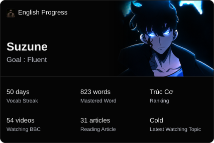

<h1 align="center">
    
</h1>
<br/>
<h2 align="center">⚒️ Languages-Frameworks-Tools ⚒️</h2>
<br/>


<div align="center">
    
    <br>
    
    
    
    
</div>
<h2 align="center">⚡ My Progress ⚡</h2>

<div align="center">
 
<br />
<br />

</div>

<h2 align="center"> 📚 Fluent English When ? 📚 </h2>


<!-- OPENQUIZ_STATS:START -->
Mastered: 715 words

<!-- VOCAB_RANK:START -->
```text
Trúc Cơ → Kết Đan  ⣿⣿⣿⣿⣿⣿⣿⣿⣿⣿⣿⣿⣿⣿⣿⣿⣿⣿⣀⣀⣀⣀⣀⣀⣀⣀⣀⣀⣀⣀  59.58%  (715 / 1200 words)
```
<!-- VOCAB_RANK:END -->

```text
⏱️ OpenQuiz Study Time

Today        5 mins

This Week    5 hrs 42 mins

Total        5 hrs 42 mins
```

```text
📅 OpenQuiz Activity

Date        Day          Time             Words
──────────────────────────────────────────────────
26.10.18    Sunday       5 mins           10 words

26.10.17    Saturday     2 hrs 49 mins    30 words

26.10.16    Friday       2 hrs 47 mins    59 words
```
<!-- OPENQUIZ_STATS:END -->

<!-- YOUPASS:START -->
```text
📋 Recent Activity

Date        Skill          Title                                                   New Vocab
────────────────────────────────────────────────────────────────────────────────────────────────────
26.10.17    Listening      Beginner bookbinding courses                              4 words

26.10.11    Reading        Sydney Opera House                                       32 words

26.10.10    Listening      Harwick Weekend Market                                   33 words
```
<!-- YOUPASS:END -->

<!-- DAILY_READING:START -->
```text
📰 Daily Reading  29 articles 🔥

Date       Topic          Article                                                  New Vocab
────────────────────────────────────────────────────────────────────────────────────────────────────
26.10.17   Manga          The Villainess Who Came to Marry-C5                       13 words

26.10.16   Manga          The Villainess Who Came to Marry-C4                       22 words

26.10.14   Manga          The Villainess Who Came to Marry-C2                       17 words
```
<!-- DAILY_READING:END -->

<!-- DAILY_WATCHING:START -->
```text
📺 Daily Watching  53 videos 🔥

Date       Topic          Title                                                    New Vocab
────────────────────────────────────────────────────────────────────────────────────────────────────
26.10.17   Gold           Why gold is so valuable                                    8 words

26.10.11   Poetry         The power of poetry                                       10 words

26.10.7    Feeling        What is that unpleasant feeling on our skin               10 words
```
<!-- DAILY_WATCHING:END -->


<h2 align="center"> 🎬 Anime & Manga 🎬 </h2>

<!--ANIME_START-->
<p align="center">
<a href="https://anilist.co/anime/206282"></a>
<a href="https://anilist.co/anime/194393"></a>
<a href="https://anilist.co/manga/184974"></a>
</p>
<!--ANIME_END-->

<h2 align="center"> 🏆 Coding Activity 🏆 </h2>

<details>
<summary> View Weekly Coding Stats</summary>

<!--START_SECTION:waka-->
 

📊 **This Week I Spent My Time On** 

```text
💬 Programming Languages: 
Other                    22 hrs 7 mins       ⣿⣿⣿⣿⣿⣿⣿⣿⣿⣿⣿⣀⣀⣀⣀⣀⣀⣀⣀⣀⣀⣀⣀⣀⣀   45.12 % 
JavaScript               12 hrs 36 mins      ⣿⣿⣿⣿⣿⣿⣀⣀⣀⣀⣀⣀⣀⣀⣀⣀⣀⣀⣀⣀⣀⣀⣀⣀⣀   25.70 % 
Markdown                 10 hrs 21 mins      ⣿⣿⣿⣿⣿⣀⣀⣀⣀⣀⣀⣀⣀⣀⣀⣀⣀⣀⣀⣀⣀⣀⣀⣀⣀   21.13 % 
CSS                      1 hr 37 mins        ⣿⣀⣀⣀⣀⣀⣀⣀⣀⣀⣀⣀⣀⣀⣀⣀⣀⣀⣀⣀⣀⣀⣀⣀⣀   03.33 % 
Java                     57 mins             ⣀⣀⣀⣀⣀⣀⣀⣀⣀⣀⣀⣀⣀⣀⣀⣀⣀⣀⣀⣀⣀⣀⣀⣀⣀   01.96 % 

🔥 Editors: 
Codex Vscode             12 hrs 53 mins      ⣿⣿⣿⣿⣿⣿⣿⣀⣀⣀⣀⣀⣀⣀⣀⣀⣀⣀⣀⣀⣀⣀⣀⣀⣀   26.30 % 
Neovim                   10 hrs 43 mins      ⣿⣿⣿⣿⣿⣀⣀⣀⣀⣀⣀⣀⣀⣀⣀⣀⣀⣀⣀⣀⣀⣀⣀⣀⣀   21.87 % 
VS Code                  8 hrs 53 mins       ⣿⣿⣿⣿⣿⣀⣀⣀⣀⣀⣀⣀⣀⣀⣀⣀⣀⣀⣀⣀⣀⣀⣀⣀⣀   18.14 % 
Opencode Cli             7 hrs 58 mins       ⣿⣿⣿⣿⣀⣀⣀⣀⣀⣀⣀⣀⣀⣀⣀⣀⣀⣀⣀⣀⣀⣀⣀⣀⣀   16.28 % 
Antigravity CLI          5 hrs 26 mins       ⣿⣿⣿⣀⣀⣀⣀⣀⣀⣀⣀⣀⣀⣀⣀⣀⣀⣀⣀⣀⣀⣀⣀⣀⣀   11.10 % 

💻 Operating System: 
Linux                    49 hrs 2 mins       ⣿⣿⣿⣿⣿⣿⣿⣿⣿⣿⣿⣿⣿⣿⣿⣿⣿⣿⣿⣿⣿⣿⣿⣿⣿   100.00 % 
```


<!--END_SECTION:waka-->

</details>
