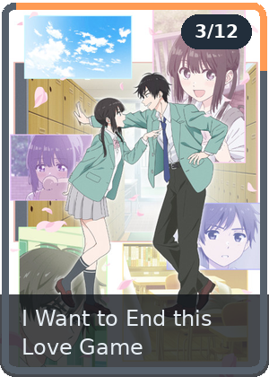
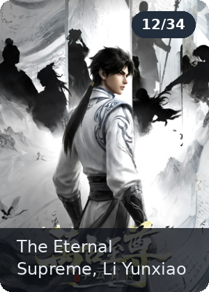

<h1 align="center">
    
</h1>
<br/>
<h2 align="center">⚒️ Languages-Frameworks-Tools ⚒️</h2>
<br/>


<div align="center">
    
    <br>
    
    
    
    
</div>
<h2 align="center">⚡ My Progress ⚡</h2>

<div align="center">
 
<br />
<br />

<br />
<br />

</div>

<h2 align="center"> 📚 Fluent English When ? 📚 </h2>


<!-- OPENQUIZ_STATS:START -->
Mastered: 913 words
<!-- OPENQUIZ_STREAK:11 -->

<!-- VOCAB_RANK:START -->
```text
Trúc Cơ → Kết Đan  ⣿⣿⣿⣿⣿⣿⣿⣿⣿⣿⣿⣿⣿⣿⣿⣿⣿⣿⣿⣿⣿⣿⣿⣀⣀⣀⣀⣀⣀⣀  76.08%  (913 / 1200 words)
```
<!-- VOCAB_RANK:END -->

```text
⏱️ English Study Time

Today        0 mins          0 words

This Week    11 hrs 24 mins    312 words

Total        65 hrs 53 mins
```

```text
📅 OpenQuiz Activity

Date        Day          Time             Words
───────────────────────────────────────────────────
26.11.25    Wednesday    3 hrs 46 mins    104 words

26.11.24    Tuesday      5 hrs 25 mins    104 words

26.11.23    Monday       2 hrs 13 mins    104 words

26.11.22    Sunday       2 hrs 41 mins    104 words
```

<!-- OPENQUIZ_DAYS:{"2026-11-25":[226,104],"2026-11-24":[325,104],"2026-11-23":[133,104],"2026-11-22":[161,104],"2026-11-21":[173,100],"2026-11-20":[195,100],"2026-11-19":[201,82]} -->
<!-- OPENQUIZ_STATS:END -->

<!-- YOUPASS:START -->
```text
📋 Recent Activity

Date        Skill          Title                                                   New Vocab
────────────────────────────────────────────────────────────────────────────────────────────────────
26.11.21    Reading        The Davies Sister                                         7 words

26.11.19    Reading        PlayingSoccer                                             8 words

26.10.24    Reading        The Lord Howe Island stick insect                        16 words
```
<!-- YOUPASS:END -->

<!-- DAILY_READING:START -->
```text
📰 Daily Reading  33 articles 🔥

Date       Topic          Article                                                  New Vocab
────────────────────────────────────────────────────────────────────────────────────────────────────
26.11.21   Manga          The Villainess Who Came to Marry-C9                        7 words

26.11.18   Manga          The Villainess Who Came to Marry-C8                       16 words

26.10.24   Manga          The Villainess Who Came to Marry-C7                       14 words
```
<!-- DAILY_READING:END -->

<!-- DAILY_WATCHING:START -->
```text
📺 Daily Watching  56 videos 🔥

Date       Topic          Title                                                    New Vocab
────────────────────────────────────────────────────────────────────────────────────────────────────
26.11.19   Generations     Learning from different generations                       5 words

26.11.18   Dreaming of …   Dreaming of being a chef                                  4 words

26.10.22   Cold           How do we adapt to the cold?                               8 words
```
<!-- DAILY_WATCHING:END -->


<h2 align="center"> 🎬 Anime & Manga 🎬 </h2>

<!--ANIME_START-->
<p align="center">
<a href="https://anilist.co/manga/184974"></a>
<a href="https://anilist.co/anime/179966"></a>
<a href="https://anilist.co/anime/194393"></a>
<a href="https://anilist.co/anime/206282"></a>
</p>
<p align="center">
<!-- BEGIN YOUTUBE-CARDS -->
<a href="https://www.youtube.com/watch?v=uYSw0MKvqCI">
  <picture>
    <source media="(prefers-color-scheme: dark)" srcset="https://ytcards.demolab.com/?id=uYSw0MKvqCI&title=Paranormal+Footage+So+Terrifying+I+Nearly+Fell+Off+My+Chair&lang=en&timestamp=1780682434&background_color=%231f2335&title_color=%23e6edf3&stats_color=%23a6adc8&max_title_lines=2&width=250&border_radius=5&duration=2150">
    
  </picture>
</a>
<a href="https://www.youtube.com/watch?v=meJK80f7A6M">
  <picture>
    <source media="(prefers-color-scheme: dark)" srcset="https://ytcards.demolab.com/?id=meJK80f7A6M&title=GERMAN+VTUBER+reacts+to+LANGUAGE+MEMES...&lang=en&timestamp=1790548490&background_color=%231f2335&title_color=%23e6edf3&stats_color=%23a6adc8&max_title_lines=2&width=250&border_radius=5&duration=2419">
    
  </picture>
</a>
<!-- END YOUTUBE-CARDS -->
</p>
<!--ANIME_END-->

<h2 align="center"> 🏆 Coding Activity 🏆 </h2>

<details>
<summary> View Weekly Coding Stats</summary>

<!--START_SECTION:waka-->
 

📊 **This Week I Spent My Time On** 

```text
💬 Programming Languages: 
Other                    20 hrs 34 mins      ⣿⣿⣿⣿⣿⣿⣿⣿⣿⣿⣿⣿⣿⣿⣿⣿⣿⣀⣀⣀⣀⣀⣀⣀⣀   66.85 % 
Java                     4 hrs 5 mins        ⣿⣿⣿⣀⣀⣀⣀⣀⣀⣀⣀⣀⣀⣀⣀⣀⣀⣀⣀⣀⣀⣀⣀⣀⣀   13.27 % 
Markdown                 2 hrs 47 mins       ⣿⣿⣀⣀⣀⣀⣀⣀⣀⣀⣀⣀⣀⣀⣀⣀⣀⣀⣀⣀⣀⣀⣀⣀⣀   09.08 % 
YAML                     1 hr 5 mins         ⣿⣀⣀⣀⣀⣀⣀⣀⣀⣀⣀⣀⣀⣀⣀⣀⣀⣀⣀⣀⣀⣀⣀⣀⣀   03.55 % 
JavaScript               49 mins             ⣿⣀⣀⣀⣀⣀⣀⣀⣀⣀⣀⣀⣀⣀⣀⣀⣀⣀⣀⣀⣀⣀⣀⣀⣀   02.69 % 

🔥 Editors: 
Codex Vscode             9 hrs 2 mins        ⣿⣿⣿⣿⣿⣿⣿⣀⣀⣀⣀⣀⣀⣀⣀⣀⣀⣀⣀⣀⣀⣀⣀⣀⣀   29.35 % 
Neovim                   6 hrs 57 mins       ⣿⣿⣿⣿⣿⣿⣀⣀⣀⣀⣀⣀⣀⣀⣀⣀⣀⣀⣀⣀⣀⣀⣀⣀⣀   22.60 % 
OpenCode                 4 hrs 32 mins       ⣿⣿⣿⣿⣀⣀⣀⣀⣀⣀⣀⣀⣀⣀⣀⣀⣀⣀⣀⣀⣀⣀⣀⣀⣀   14.76 % 
IntelliJ IDEA            2 hrs 40 mins       ⣿⣿⣀⣀⣀⣀⣀⣀⣀⣀⣀⣀⣀⣀⣀⣀⣀⣀⣀⣀⣀⣀⣀⣀⣀   08.71 % 
VS Code                  2 hrs 27 mins       ⣿⣿⣀⣀⣀⣀⣀⣀⣀⣀⣀⣀⣀⣀⣀⣀⣀⣀⣀⣀⣀⣀⣀⣀⣀   07.96 % 

💻 Operating System: 
Linux                    30 hrs 47 mins      ⣿⣿⣿⣿⣿⣿⣿⣿⣿⣿⣿⣿⣿⣿⣿⣿⣿⣿⣿⣿⣿⣿⣿⣿⣿   100.00 % 
```


<!--END_SECTION:waka-->

</details>
