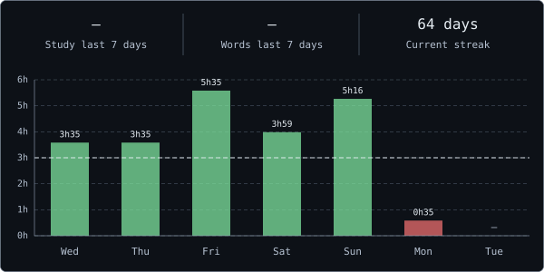
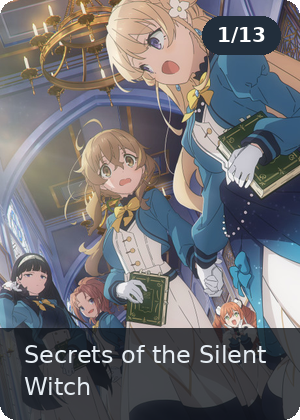
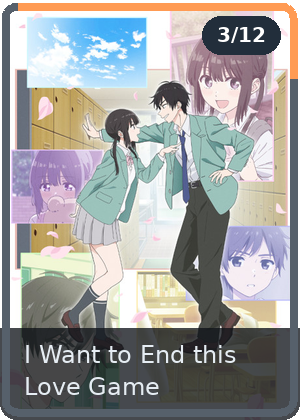
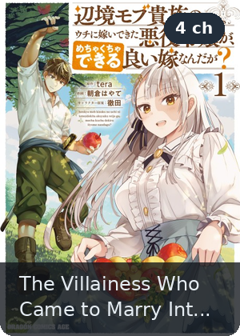
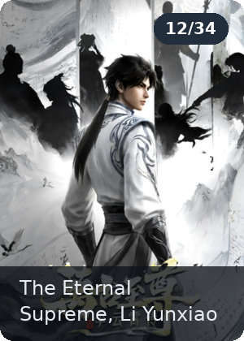

<h1 align="center">
    
</h1>
<br/>
<h2 align="center">⚒️ Languages-Frameworks-Tools ⚒️</h2>
<br/>


<div align="center">
    
    <br>
    
    
    
    
</div>
<h2 align="center">⚡ My Progress ⚡</h2>

<div align="center">
 
<br />
<br />

</div>

<h2 align="center"> 📚 Fluent English When ? 📚 </h2>


<!-- OPENQUIZ_STATS:START -->
Mastered: 831 words
<!-- OPENQUIZ_STREAK:68 -->

<!-- VOCAB_RANK:START -->
```text
Trúc Cơ → Kết Đan  ⣿⣿⣿⣿⣿⣿⣿⣿⣿⣿⣿⣿⣿⣿⣿⣿⣿⣿⣿⣿⣿⣀⣀⣀⣀⣀⣀⣀⣀⣀  69.25%  (831 / 1200 words)
```
<!-- VOCAB_RANK:END -->

```text
⏱️ English Study Time

Today        1 hr 4 mins      0 words

This Week    2 hrs 21 mins    75 words

Total        35 hrs 17 mins
```

```text
📅 OpenQuiz Activity

Date        Day          Time             Words
──────────────────────────────────────────────────
26.10.28    Wednesday    1 hr 4 mins      0 words

26.10.27    Tuesday      26 mins          30 words

26.10.26    Monday       50 mins          45 words

26.10.25    Sunday       5 hrs 16 mins    59 words
```

<!-- OPENQUIZ_DAYS:{"2026-10-28":[64,0],"2026-10-27":[26,30],"2026-10-26":[50,45],"2026-10-25":[316,59],"2026-10-24":[239,98],"2026-10-23":[335,69],"2026-10-22":[215,54]} -->
<!-- OPENQUIZ_STATS:END -->

<!-- YOUPASS:START -->
```text
📋 Recent Activity

Date        Skill          Title                                                   New Vocab
────────────────────────────────────────────────────────────────────────────────────────────────────
26.10.24    Reading        The Lord Howe Island stick insect                        16 words

26.10.22    Listening      Fairmead online delivery                                  2 words

26.10.17    Listening      Beginner bookbinding courses                              4 words
```
<!-- YOUPASS:END -->

<!-- DAILY_READING:START -->
```text
📰 Daily Reading  31 articles 🔥

Date       Topic          Article                                                  New Vocab
────────────────────────────────────────────────────────────────────────────────────────────────────
26.10.24   Manga          The Villainess Who Came to Marry-C7                       14 words

26.10.22   Manga          The Villainess Who Came to Marry-C6                       13 words

26.10.17   Manga          The Villainess Who Came to Marry-C5                       13 words
```
<!-- DAILY_READING:END -->

<!-- DAILY_WATCHING:START -->
```text
📺 Daily Watching  54 videos 🔥

Date       Topic          Title                                                    New Vocab
────────────────────────────────────────────────────────────────────────────────────────────────────
26.10.22   Cold           How do we adapt to the cold?                               8 words

26.10.17   Gold           Why gold is so valuable                                    8 words

26.10.11   Poetry         The power of poetry                                       10 words
```
<!-- DAILY_WATCHING:END -->


<h2 align="center"> 🎬 Anime & Manga 🎬 </h2>

<!--ANIME_START-->
<p align="center">
<a href="https://anilist.co/anime/179966"></a>
<a href="https://anilist.co/anime/194393"></a>
<a href="https://anilist.co/manga/184974"></a>
<a href="https://anilist.co/anime/206282"></a>
</p>
<p align="center">
<!-- BEGIN YOUTUBE-CARDS -->
<a href="https://www.youtube.com/watch?v=eoeVP7rP184">
  <picture>
    <source media="(prefers-color-scheme: dark)" srcset="https://ytcards.demolab.com/?id=eoeVP7rP184&title=B1%E2%80%93B1%2B+English+Listening+Practice+%7C+1+HOUR+of+Real+English+Conversations+%7C+Life%2C+Health+%26+Psychology&lang=en&timestamp=1789906250&background_color=%231f2335&title_color=%23e6edf3&stats_color=%23a6adc8&max_title_lines=2&width=250&border_radius=5&duration=3756">
    
  </picture>
</a>
<a href="https://www.youtube.com/watch?v=1VQNMDSzWpE">
  <picture>
    <source media="(prefers-color-scheme: dark)" srcset="https://ytcards.demolab.com/?id=1VQNMDSzWpE&title=What+is+that+unpleasant+feeling+on+our+skin+and+is+scratching+good+for+us%3F+%E2%8F%B2%EF%B8%8F+6+Minute+English&lang=en&timestamp=1790238151&background_color=%231f2335&title_color=%23e6edf3&stats_color=%23a6adc8&max_title_lines=2&width=250&border_radius=5&duration=362">
    
  </picture>
</a>
<!-- END YOUTUBE-CARDS -->
</p>
<!--ANIME_END-->

<h2 align="center"> 🏆 Coding Activity 🏆 </h2>

<details>
<summary> View Weekly Coding Stats</summary>

<!--START_SECTION:waka-->
 


<!--END_SECTION:waka-->

</details>
